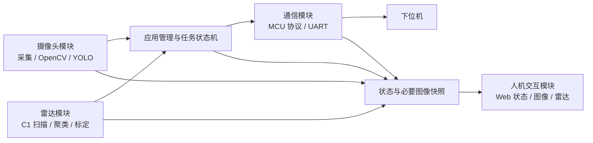

# 项目架构

## 2026-11-18 当前实现增补

最新标靶输出按SERIAL_PROTOCOL.md统一为0x55：α、dx/dy与来源。YOLO粗定位实时输出标靶二中心差；角度达标后，OpenCV跟踪三个圆心并更新α和标靶二偏差，角度超限恢复YOLO。颜色物块报文保持原格式。CameraFrame新增target_alpha，通信层仅编码，不计算图像几何。下文0x54及两两连线角度描述属于旧版本。

后续用户授权的独立物块实机测试已完成：自动进入1080p圆定位并输出标靶二偏差，超时恢复YOLO及资源释放通过；修正UVC菜单回读和圆尺度限制。具体数值与未验收项目见TODO2_ALIGNMENT.md最新实机记录。本项目完整任务和MCU闭环仍未验收，不能继续引用下文初始交付时“全部硬件未测试”的状态概括本轮独立链路。

启动入口为start.sh和start_coloritems.sh，两者默认work，可传debug及--check/--check-files。CLI共用同一Application，runtime_output.py仅决定诊断去向：work留档到log/runtime，debug显示终端，包含Python与原生输出。模式不改变设备、算法或报文；显式配置检查会显示结果且不开设备。

用户选择本四模块版作为新板端项目，目标目录`/root/Monthwu/GongChuang_vision_26`；旧实机项目及回滚备份归档。是否完成部署及实际归档路径见本轮交付记录，不能仅凭本段目标路径判定运行。

TODO2新增camera/focus.py门控、native/target_focus.cpp圆检测、camera/module.py分辨率切换及application.py精定位分流。CameraFrame包含focus_active及当帧focus_delta；通信模块独立编码0x54有符号像素偏差。条件为三类标靶同时有效、所有连线角度<=3°、targetTwo唯一最近；1080p期间暂停YOLO，MCU结束/取消或失败超时后恢复普通模式。详见[TODO2_ALIGNMENT.md](TODO2_ALIGNMENT.md)。

board.json采用UART2、DCXIN相机、当前实机新模型与类名。board-object.json直接物块。2026-11-18本地TODO1已实现有/无雷达两个分项目，共用四模块源码；根start.sh默认选择projects/without_radar，with-radar参数选择projects/with_radar。用户后续明确无雷达版直接二维码→物块，禁用雷达、预扫描和上位机规划，不需要route.json。动态版依赖有效定位快照和同步雷达观测重算，结果只进入HMI，不发送运动报文；场地及雷达device待填写。本地分项目尚未部署；本轮已授权测试通过内存载入当前CameraModule，独立实测二维码识别成功，不代表板端持久源码已更新。扫码器硬件TODO3仍未实现。细节见TODO1_NAVIGATION.md。

## 范围与权威

用户要求依据现有有效代码重写项目，并按 `command.md` 分成摄像头、雷达、通信、人机交互四模块。源码位于本地 `car26_new`，2026-11-18已部署到板端 `/root/Monthwu/GongChuang_vision_26`，ARM64原生库及ROS2包构建、51项人工/模拟测试通过。旧car26_ws已归档；新项目保持停止，真实硬件效果尚未验收。

## 应用结构

用户2026-11-07补充的实车约束见[SLAM_FIELD_CONSTRAINTS.md](SLAM_FIELD_CONSTRAINTS.md)与`simulation/field_constraints.json`：二维码板沿地图边缘在允许范围内平移、下沿仍接地，不能把固定仿真板端点当作已测地标；工作扫描可见二维码板、地面物块与本车轮子；雷达实际伸出车体，伸出后的外参、零角和误差等待用户实测标定。最新要求恢复仿真轮子回波，Auto在简化车体SLAM下使用wheels，仅四轮恢复雷达可见性。前端仍过滤几何匹配的自体回波，物理阴影保留，当前预设近处圆柱可能被轮子遮挡。目前范围搜索/板车联合估计尚未实现，robot外参接口仍只含平移并假设雷达yaw=0；具体沿边摆放范围尚未知。当前标定/板几何门控保持关闭，文档记录不等同于实机验收。

2026-11-07扫描高度修正保留：生成场景按扫描高度排除地面/印刷/标靶底板等较低外观的雷达可见层，保留GUI和碰撞体，雷达垂直层显式为0角度单层。测试默认扫描高17.619mm，高于标靶区10.2mm与地面印刷0.2mm；二维码板、圆柱及转盘不排除。此处理在场景模型层进行，不向估计器提供物体坐标或删除地图中的指定区域。同日早期Disabled对照曾验证两圆柱6/3点、两个标靶0点；该无遮挡结果不适用于最新恢复轮子后的遮挡场景。非SLAM及直接生成器仍默认Model，详细CAD的Auto也使用Model，显式Disabled可复现无遮挡对照。

2026-11-07场地几何修正：用户确认二维码板下沿应接地。`field_geometry.py` 在生成场景时将整块板的中心由0.200m降至0.105m（板高0.210m），外观、碰撞、贴图统一移动，保持XY与朝向；普通场地、固定雷达与整车/SLAM入口共用该修正，上游资源保持不变。因此下文旧记录中的“雷达扫描面低于板下沿”已解除；初始定位仍须满足标定、点数与遮挡门限。

SLAM仿真会自动打开独立的 `map_viewer.py` 桌面窗口，呈现占据图、位置/朝向与有界历史轨迹，支持缩放平移。2.4米场地固定分成5行×5列（每格0.48米），不同于25毫米建图分辨率。生成器单独写`.view.json`供视图按所选蓝区的仿真车体起点对齐；图像、轨迹、朝向共用同一变换，并标示“显示对齐，定位尚未确认”。该文件及出生位姿不进入Cartographer或C++前端，`.robot.json`仍只含标定和自体掩码，三值接口门控保持原状。算法确认场地位姿后按时间戳相同的局部/场地位姿切换显示变换。地图窗口关闭后仿真继续；主会话结束时关闭其创建的窗口进程。仅该视图使用Tk/Pillow，不改变C++估计核心或下位机接口。

Windows侧的仿真环境位于 `simulation/`，使用独立WSL2 Ubuntu 24.04 / ROS 2 Jazzy / Gazebo Harmonic，上游场地保留。默认车体由16个几何物体组成，不加载详细CAD网格，折叠后完整放在蓝区1，也可选蓝区2。雷达位置沿用CAD元数据，光学中心、零角与倒装原始角度极性仍未实测。C1输出ROS LaserScan；HWT101按用户确认模拟100 Hz单轴Z角度/角速度，Gazebo适配器丢弃其他IMU通道，不打开实机设备。实际启用帧、电气接口、轴向与零位待确认。

`simulation/slam/car26_slam` 是单独的ROS C++包：车体回波过滤后送Cartographer 2D建图，自有前端用单轴相对转角辅助输出航向，不伪造完整IMU，也未向Cartographer后端加入单轴因子。蓝区先验与连续有限板段匹配用于确认 `race_map` 对齐；未确认、观测结构不足、近距参考丢失或数据过期时不发布三数值。下位机仿真边界 `/car26/pose_xy_yaw` 只含x/y/yaw（Vector3字段x/y/z分别为m/m/度），内部置信状态独立。二维码板已按用户纠正下沿接地，雷达扫描面与板在高度上相交，但场地坐标仍须经过点数、遮挡与标定检查，不能把已知出生位置当作估计值。代码仅读取去除世界位姿/障碍信息的 `.robot.json`，真值只用于独立评估。实际比赛场地运动、底盘驱动、人员处理和静态障碍物重叠切换尚未实现；当前通过独立运动回放及静态Gazebo检查，不能替代实机验收。详见 `simulation/slam/README.md`。

仿真运动约束见 `simulation/motion_rules.json`：从选定蓝区出发并返回原蓝区，完全离开后沿灰色车道行驶。生成器已加载蓝区坐标与初始包络，使用简化折叠机械手满足300 mm投影、400 mm高度限制，西向仅为仿真预设。行驶区域、返回、停车与实际机构折叠尚未实现或验收，不改变下述实机业务流程。

`car26/application.py` 创建模块、执行任务动作并统一关闭资源。`mission.py` 是无设备依赖的状态机。四模块使用不可变结果对象和有界状态快照，不传递 ROS 消息，也不启动旧节点。可选 `car26.launch.py` 只启动同一个应用进程。

| 模块 | 源码 | 职责 |
| --- | --- | --- |
| 摄像头 | `car26/camera/` | 一个相机工作线程拥有当前角色设备；采集、推理、过滤、可选录像及预览编码；仅存最新结果 |
| 雷达 | `car26/radar/` | 一个工作线程独占 C1 设备；查询、健康检查、转速、扫描解析、圆周聚类及 STOP 清理 |
| 通信 | `car26/communication/` | 应用主线程独占 MCU 串口；命令分帧、协议编码、部分写入补齐、发送完成检查 |
| 人机交互 | `car26/hmi/` | 读取快照和 JPEG；显示状态、事件、雷达与相机；不发运动命令 |

共享 `types.py` 定义结果对象，`telemetry.py` 保存每个模块当前状态、最近 100 个事件、每个角色最新一帧 JPEG。没有增长中的推理队列；慢处理时优先消费最新结果。

## 任务流程

完整入口：`WAIT_START → WAIT_SHOT → COLLECT`，三次角度依次为 0/45/90。每次只累计触发后、独立且新鲜的数据帧。每帧每候选最多一票，达到两帧阳性可提前完成；否则在收集超时后完成本次扫描。缺少传感器数据时直接失败。三次后按票数和置信度选唯一障碍，要求至少两票、占总票数至少 0.7；否则失败，不发送地图。

握手及每次扫描成功回小写 `[ack]`，三次扫描后地图只发一次。`[skip]` 可从初始等待直接进入 QR；QR 简化入口不做地图流程。初始等待无超时；三次 `[shot]` 等待有配置超时。重复起点和扫描期间重复 `[shot]` 忽略，避免重复发送地图。

QR 阶段保持非空 UTF-8 原文，不裁剪或套用旧任务码校验。四次 UART 写入及 flush 成功后进入 OBJECT，再关闭 QR 相机、打开物块相机。失败退出并清理，不能把“已进入下一状态”当作写入成功。写入/flush 仅证明主机串口完成，不证明 MCU 已解析。

2026-11-18扫码审查修复：相机为首个待消费的非空扫码结果保留独立单槽事件，视频快照继续更新；`result()`优先消费该事件，保留原帧序号与采集时间，原有过期检查继续适用。关闭或切换角色时清空事件及旧帧。OpenCV的UTF-8解码异常触发备用解码，pyzbar逐个跳过非法UTF-8、空内容和非二维码候选，保留首个有效候选的原文。此修复不引入MCU ACK，也不改变四次发送与flush协议；发送整体超时仍待后续完善。

扫码范围默认整帧：`cameras.qr.roi=null`或缺省时不裁剪，两个解码器都读取完整画面；只有手动填写像素矩形[x,y,width,height]才限制区域。禁止ROI越界或静默回退到中心区域。物块ROI及雷达地图标定不限制二维码画面。运行状态显示有效qr_roi与vision_mode=qr。原新架构代码本已使用整帧，本次将其显式配置并增加四角二维码回归检查，未声称修复了原本不存在的中心裁剪。

OBJECT 阶段只向 MCU 发送过滤后的结果：距参考像素点最近的一个物块，及所有有效标靶。面积 2000、中心高度比例 0.5、标靶 2/3 重合规则和物块覆盖标靶规则依据当前本地有效修改。未知新相机使用中性色彩增益，旧相机增益只放在迁移对照配置。

## 雷达与地图坐标

C1 接入使用 460800、8N1，扫描模式为 Standard，非 DenseBoost。C1 的正角顺时针转换到车体前方 +x、左侧 +y，长度单位米。聚类得到车体相对障碍物，供 HMI 显示。

地图匹配须提供 `[x_m,y_m,yaw_deg]` 安装外参、每个起点三次扫描的实际朝向和候选格中心坐标；目标坐标在该起点的标定参考系中表达。接收 `[shot]` 只说明 MCU 触发了该阶段，不证明云台或车体已到位。不能自动从 5×5 格号猜测雷达地图。多个匹配门重叠时不投票。

旧相机 ROI 映射为迁移对照选项，独立于雷达处理。保存的 ROI 适用于原 1280×720 相机和起点 4；起点 24 需要独立标定。

## 模式、资源与定位

`--mode work|debug` 只设置日志等级；业务参数和流程共用。传感器异常、串口异常、状态机失败统一非零退出。SIGINT/SIGTERM 请求关闭相机、雷达、HMI 和 MCU 串口；退出不使用按名称杀进程、GPIO 关机或旧 `/kill` 话题。

相机驱动可能阻塞在 OpenCV `read()`；关闭等待 5 秒仍未结束时报告 `CAMERA_STOP_TIMEOUT`，不重新打开另一设备。Python 无法强制结束阻塞线程，这种驱动故障可能需用户终止进程，须在实机验收中验证。采集时间使用 read 前主机单调时间，不能作为曝光时间或端到端硬件延时证据。

定位入口：设备配置看 `config.py`，扫码到物块切换看 `application.py/mission.py`，框过滤看 `camera/processing.py`，模型解码看 `camera/detector.py`，协议看 `communication/protocol.py`，雷达解码看 `radar/protocol.py`，地图映射看 `mapping.py`。
